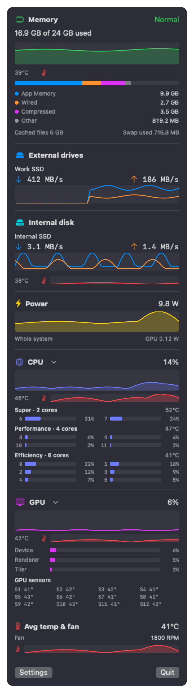

# Lanes

[](https://github.com/jonathanbrantner/lanes/actions/workflows/build.yml)
[](https://github.com/jonathanbrantner/lanes/releases/latest)


A tiny macOS menu bar monitor for memory and external SSD speed.

Lanes shows how much memory is in use and how fast your external drives are reading and
writing, right in the menu bar. Click it for a panel with charts. It uses about 14 MB of
memory and 0.2% CPU while idle.

**New: temperatures are now available.** Lanes can show CPU, GPU and SSD temperatures (and memory
on chips that have a memory sensor) right inside each panel section, plus an average temperature
and fan speed. Switch between °C and °F in Settings. See [Features](#features).

<p align="center">
  <br>
  
</p>

Pictures are rendered by the app from demo data (`scripts/make-screenshots.sh`).

## Why

Most menu bar monitors show the internal disk. If you work off an external SSD, that is
the drive you want to watch. Lanes shows each external drive by its volume name, with
separate read and write speeds, and stays out of the way.

## Features

- External drives by volume name ("Work SSD", not "M.2 P320 512GB"), with read and write
  MB/s and a 60 second chart per drive. Drives appear and disappear as you plug them in.
- Memory as Activity Monitor counts it (app, wired, compressed), with the menu bar value
  turning amber or red when macOS reports memory pressure. Cached files and swap listed.
- Optional: internal disk I/O, whole-system power in watts, CPU and GPU usage, and
  temperatures (CPU, GPU, SSD) in °C or °F, with fan speed on Macs that have a fan.
- Optional core details: the load of every CPU core, grouped as Super, Performance and Efficiency
  cores, with one temperature per group, and the GPU's Renderer and Tiler load with its separate
  temperature sensors. macOS does not report per-core temperatures or per-GPU-core load, so Lanes
  shows what it does report and never guesses.
- Settings for what shows in the menu bar and in the panel, the update interval
  (1, 2 or 5 seconds), and start at login.
- Light: one low-priority sampler thread, one kernel call per reading, nothing drawn while
  the panel is closed. No helper tool, no admin rights, no network.

## Install

### Download

1. Get the latest `Lanes-<version>.zip` from [Releases](https://github.com/jonathanbrantner/lanes/releases/latest).
2. Unzip and move `Lanes.app` to your Applications folder.
3. The first time, right-click `Lanes.app` and choose **Open**, then **Open** again.
   macOS shows this warning because the app is not notarized (that needs a paid Apple
   developer account). After the first launch it opens normally.

Lanes lives in the menu bar and has no Dock icon. Quit it from its panel.

### Build from source

Needs Xcode 15 or newer (for the Swift toolchain).

```sh
git clone https://github.com/jonathanbrantner/lanes.git
cd lanes
scripts/install.sh
```

This builds a release binary, wraps it in `Lanes.app` with a generated icon, signs it for
your Mac and copies it to `/Applications`. Then open Lanes like any other app.

## Requirements

- macOS only, on an Apple Silicon Mac (M1 or later), macOS 14 or newer. No Intel Macs.
- Power, temperature and fan readings come from Apple-private interfaces (SMC, IOReport and IOHID) that can change
  between macOS versions. When a reading is not available, Lanes hides that row instead of
  showing a made-up number. CPU, memory and Neural Engine power are not shown because they
  are not exposed without admin rights.
- Temperature sensors are named differently on every chip generation. Lanes has a sensor table
  for M1, M2, M3, M4, M5 and M6 (taken from the open-source Stats app's sensor list, and checked
  on an M6 only). It picks yours automatically; if temperatures are missing, choose your chip in
  Settings. Newer chips fall back to "Other / newer", which scans for sensors.

## How it works

Drive speeds come from the byte counters IOKit keeps for every block device; Lanes reads
them once per tick and takes the difference. Drives are discovered through DiskArbitration
events, so nothing is scanned while nothing changes. Memory and CPU come from `host_statistics`.
Everything runs on one utility-priority queue, which macOS schedules on the efficiency cores,
and the menu bar icon is only redrawn when a number actually changes.

Two command line tools are included for checking the readings:

```sh
swift run drivemon            # read/write MB/s per external drive, once a second
swift run drivemon --internal # include the internal disk
swift run powermon            # every power reading this Mac exposes
```

## Accuracy

Lanes is meant to agree with Activity Monitor, not just be close. "Memory Used" follows
Activity Monitor's definition (physical memory minus free minus file-backed cache, verified
against it to 0.03%), and the displayed CPU and drive figures are averaged over the same
5 second window Activity Monitor uses, so the two agree to within a point. You can check on
your own Mac:

```sh
swift run lanes-verify 10     # 10 s window; copy a large file meanwhile to exercise the disks
```

It samples Lanes' own collectors and, over the same window, `vm_stat`, `top` and `iostat`,
then prints each value next to its reference with the error. It exits non-zero if anything
is off by more than 1%. GPU and power have no root-free reference; `sudo powermetrics` is the
only cross-check for those.

## Uninstall

Quit Lanes from its panel, delete `Lanes.app` from Applications, and optionally remove the
settings with `defaults delete app.lanes.menubar`.

## Lanes and Stats

[Stats](https://github.com/exelban/stats) is a far more complete monitor and the right
choice if you want sensors, fans, network and widgets. Lanes exists for one job, external
drive speed, with the smallest footprint I could manage.

## License

MIT. See [LICENSE](LICENSE).
